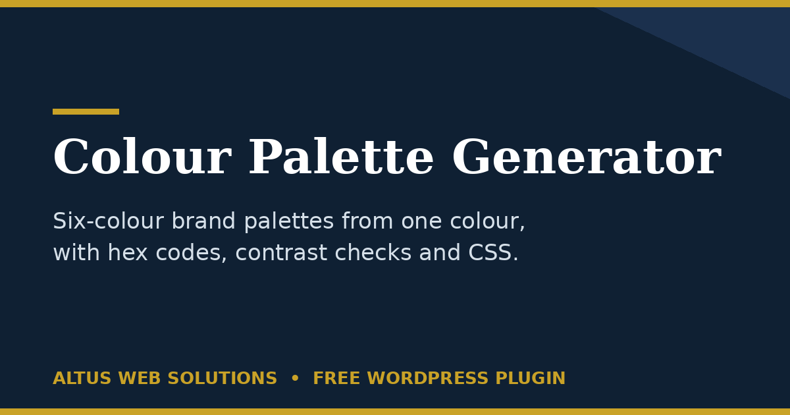

# Altus Colour Palette Generator — Free WordPress Plugin

**A free brand colour palette generator for WordPress: pick one base colour and get a complete 6-colour brand palette — Primary, Secondary, Accent, Dark, Light and Neutral — with hex codes, WCAG contrast badges and ready-to-paste CSS variables, in seconds.**

> **⬇️ Download now:** get the latest release zip from the [**Releases page**](../../releases) → WordPress → Plugins → Add New → Upload Plugin → Install Now → Activate → add the shortcode `[altus_colour_palette_generator]` to any page.

**Keywords people search for:** brand colour palette generator, free colour palette generator, small business brand colours, hex code generator, wcag contrast checker, brand palette for website, colour scheme generator, css colour variables, complementary colour palette, brand colours uk.

## What it does

Most small-business websites pick colours by accident: the default blue from the theme, a red borrowed from a competitor, three shades that fight each other on the same page. Visitors notice, even if they can't say why — the site just feels "off", and "off" doesn't get enquiries.

A proper brand palette is not about taste. It's about roles. Every colour on your site should have a job: one colour leads (your primary), one or two support it (secondary), one grabs attention at the moments that matter (accent), and quiet tones handle backgrounds, text and borders. When each colour knows its job, the whole site looks deliberate — and deliberate looks trustworthy.

This generator builds exactly that: a six-colour palette from any base colour you give it. Pick your logo colour, your favourite, or just one you like. The tool does the colour theory — complementary, analogous, triadic or monochrome schemes — and hands you hex codes, usage guidance, contrast checks and ready-to-paste CSS variables you can give to any web designer. Everything runs in the visitor's browser; nothing you enter leaves your device.

## Who it is for

- **Small-business owners** who need a brand palette for their website but don't have a designer on call — plumbers, cafés, salons, accountants, builders, florists and anyone whose site currently has colours picked by accident.
- **Freelancers and web designers** who want exact hex codes, contrast badges and CSS variables to hand to a client or paste straight into a site, without opening a design tool.
- **New businesses** choosing their brand colours for the first time and wanting a palette that actually works together instead of five colours that fight on the page.
- **Anyone rebranding on a budget** — a new palette is the cheapest visible change you can make to a tired website, and this one is free.

## The problem it solves

Picking brand colours by guesswork produces the same five failures again and again: no primary colour (everything shouts at once), colours borrowed from competitors, text fighting its background, the accent colour used everywhere so it stops being an accent, and no written hex codes anywhere — so the designer, the printer and the website all use slightly different blues.

This plugin fixes all five in one go. It assigns every colour a role, checks every colour's contrast before you use it, and writes the hex codes down for you — as copy-paste CSS variables and as a downloadable report. The same base colour, scheme and style always produce the same palette (deterministic), so you can reproduce it exactly months later, and the built-in 60-30-10 guide tells you how to actually apply the six colours on a real page instead of just admiring them.

## Features — and why each one matters

### A complete palette, not a random swatch

- **Six colours with roles: Primary, Secondary, Accent, Dark, Light and Neutral.** Why it matters: roles are what make a palette usable. The primary carries your structure (headers, buttons, links); the secondary supports it; the accent appears only where you want action (prices, "Book now"); dark, light and neutral handle text, backgrounds and borders. Six is plenty for a small-business site — more than that and the site starts looking random.
- **Every colour with its hex code and RGB values — click any hex to copy it.** Why it matters: a hex code is the one exact way to describe a colour on the web. Give the codes to any designer or paste the CSS into your site and the colours match exactly, everywhere.

### Contrast checked before you use it

- **A WCAG contrast badge on every swatch: AA, Large text, or Decorative only.** Why it matters: a colour that looks fine as a button can be unreadable as text. "AA" means body text is comfortably readable for most people; "Large text" means it's fine for big headings; "Decorative only" means don't put readable text on that colour. The badges follow WCAG 2.x contrast ratios (white on black = 21:1), and each swatch also tells you the best text colour to put on it — white or near-black — with its exact ratio.
- **The fine print says it plainly: always check text legibility yourself on your real website before publishing.** Why it matters: screens and print render colour slightly differently, and a ratio is a guide, not a guarantee. The tool gives you the numbers; your eyes make the final call.

### Five schemes × four styles = twenty palettes from one colour

- **Five colour schemes: Brand blend, Complementary, Analogous, Triadic and Monochrome.** Why it matters: the scheme is the personality. Brand blend suits most businesses; Complementary gives bold contrast; Analogous is calm and harmonious; Triadic is lively without clashing; Monochrome is a single-colour brand done properly.
- **Four brand styles: Professional, Vibrant, Soft & friendly, and Bold & dark.** Why it matters: the same base colour reads completely differently as a corporate navy than as a vibrant purple. Professional tones things down for corporate audiences; Vibrant turns the energy up; Soft suits care, health and education brands; Bold & dark gives a premium evening feel.
- **Deterministic — the same inputs always give the same palette.** Why it matters: you can come back next month, enter the same base colour, scheme and style, and get the same six hexes. No surprises, no "it was slightly different last time".
- **"Surprise me" generates a random palette when you want inspiration instead of a starting colour.** Why it matters: sometimes you don't have a logo colour yet — you just know the site looks tired. One click gives you somewhere to start.

### Export it properly

- **Ready-to-paste CSS variables (`--brand-primary` and friends) with Copy and Download palette.css.** Why it matters: variables are how a designer actually uses a palette. Paste the block into your stylesheet and every colour is named, consistent and changeable in one place.
- **A plain-text report you can download** — all six colours with hex codes, contrast ratios, best text colours and the 60-30-10 usage guide. Why it matters: the report is the thing you hand to your designer, your printer or your developer. It travels further than a browser tab.
- **A "How to use these six colours" guide built into the result, explaining the 60-30-10 rule.** Why it matters: a palette you don't know how to apply is just six pretty squares. The rule is simple — about 60% of the page stays light backgrounds, 30% carries your brand colours, 10% is the accent — and because the accent is rare, it gets noticed.

### Private by design

- **100% client-side: no server endpoint, no database table, no file written on the server, no third-party libraries.** Why it matters: nothing you enter — your base colour, your business name — leaves your device. There is no server to leak it, no account to create, and no email form standing between you and your palette.
- **No email gate in this version.** Why it matters: the result is on the screen immediately — swatches, badges, CSS, downloads — with no name and email address required.

## How it works

1. Add the shortcode `[altus_colour_palette_generator]` to a page.
2. A visitor sets their base colour — the colour picker, or a typed hex code like `#2e6bff`. Their logo colour is the best starting point.
3. They choose a scheme (Brand blend suits most businesses) and a style (Professional for corporate, Vibrant for energy, Soft for care and education, Bold & dark for premium).
4. They click **Generate my palette** and get six swatch cards — colour chip, name, usage note, hex with tap-to-copy, and a contrast badge.
5. They read the contrast badges before putting text on a colour, then copy the CSS variables into their site, download `palette.css`, or download the plain-text report to hand to their designer.
6. They follow the built-in 60-30-10 guide to apply the palette: 60% light backgrounds, 30% brand colours, 10% accent.

Everything happens in the browser. No account, no email address, no data sent anywhere.

## Installation (2 minutes, from the release zip)

1. Download the latest `altus-colour-palette-generator-v1.0.0.zip` from the [**Releases page**](../../releases).
2. In WordPress, go to **Plugins → Add New → Upload Plugin**, choose the zip, click **Install Now**, then **Activate**.
3. Create or edit a page and add the shortcode: `[altus_colour_palette_generator]`
4. Publish the page. Done — visitors can generate palettes from it.

## Frequently asked questions

**Is the Colour Palette Generator really free?**
Yes. The tool, the CSS export and the downloads are all free, no account needed.

**How many colours should my brand have?**
Six is plenty for a small business website: one primary, one or two supporting colours, one accent, plus dark, light and neutral tones for text and backgrounds. More than that and the site starts looking random.

**What does the contrast badge mean?**
It shows the contrast ratio between the swatch and text on top of it, following the WCAG accessibility standard. "AA" means body text is comfortably readable for most people. "Large text" means it is fine for big headings. "Decorative only" means don't put readable text on that colour — use it for backgrounds and shapes instead.

**What is a hex code?**
A hex code like `#2e6bff` is the standard way websites describe an exact colour. Six characters after the `#` define the red, green and blue mix. Give the hex codes to any designer, or paste the CSS variables into your site, and the colours will match exactly.

**How do I actually use the six colours on my website?**
Follow the 60-30-10 rule in the built-in guide: about 60% of the page stays light backgrounds, 30% carries your brand colours (headers, buttons, links), and 10% is the accent — prices, "Book now", limited offers. Because the accent is rare, it gets noticed.

**Can I use this palette in print too?**
Yes — the hex codes convert cleanly to print colours in any design software. Just note that screens and printers render colour slightly differently, so proof anything critical before a big print run.

**Does anything I enter leave my computer?**
No. All palette generation runs in your browser. In this open-source version there is no email option at all — nothing you enter is sent anywhere, stored anywhere, or seen by anyone.

## Honest limits

- **Colour theory, not taste.** The tool builds palettes from standard colour theory — it can't tell you whether a palette feels right for your particular customers. If a palette looks wrong to you, trust your eyes and try another scheme or style.
- **Screens and print differ.** Hex codes are exact on screen; printers render colour slightly differently. Proof anything critical before a big print run.
- **Contrast ratios are a guide, not a guarantee.** A badge tells you the measured ratio; real legibility also depends on font size, weight and the device. The tool's own fine print says the same: check text on your real website before publishing.
- **Six colours, by design.** The tool always produces exactly six roles. If your brand genuinely needs more (a second accent, a seasonal colour), add it by hand — but most small-business sites are better for the discipline.
- **No saved palettes.** This open-source version stores nothing, so a palette you like should be copied or downloaded before you leave the page — there is no account to save it to.

## Changelog

### 1.0.0

First public release (stripped open-source version). 6-colour brand palettes from any base colour: 5 colour schemes (Brand blend, Complementary, Analogous, Triadic, Monochrome) × 4 brand styles (Professional, Vibrant, Soft & friendly, Bold & dark), hex codes with click-to-copy, WCAG 2.x contrast badges (AA / large text / decorative) with best-text-colour guidance, usage notes per colour, ready-to-paste CSS variables with Copy + Download palette.css, plain-text report download, a built-in 60-30-10 usage guide, and a "Surprise me" random palette. Email delivery, lead storage and email sending removed — the full result is shown on screen instead. The colour logic passed a 474-test Node harness (hex parsing, HSL roundtrips, hue rotation, tint/shade/mix, contrast ratios including white-on-black = 21:1, palette determinism across all 20 scheme×style combinations, 6 unique hexes including near-black/white edge bases, CSS export format, text report, no support@ anywhere).

## What data does this tool handle?

This GitHub version contains NO lead capture, NO email sending, and NO data storage — results are shown on screen only. The version hosted on altuswebsolutions.com may offer email delivery; this open-source version does not. Nothing the visitor enters — base colour, scheme, style, business name — leaves their browser: there is no server endpoint in this version, no database table is created, no file is written on the server, and nothing is transmitted to any external service. Palettes are generated in the browser and copied or downloaded directly from the page.

## Disclaimer

This software is provided free of charge, "as is", WITHOUT warranty of any kind, express or implied, including but not limited to the warranties of merchantability and fitness for a particular purpose. The authors are NOT liable for any loss, damage or cost arising from the use of this software, including but not limited to a palette that does not suit a particular brand, or time spent installing it. Always back up your WordPress site before installing any plugin, and test new plugins on a staging site where possible. Palettes are generated from standard colour theory and contrast ratios are a guide — always check text legibility yourself on your real website before publishing.

## Licence

GPLv2 or later. See [LICENSE](LICENSE).
